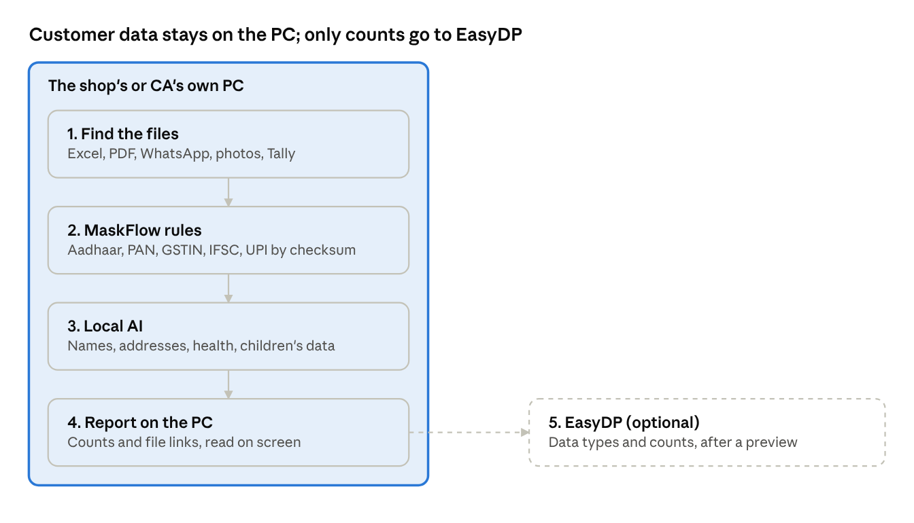

# EasyDP Local PII Scanner — Plan

Oct 16, 2026 · SEDHU

## The basic idea

A small app runs on the shop's or CA's own Windows PC and finds customer data in their files. Nothing is uploaded: the actual Aadhaar numbers, names and phone numbers never leave the PC.

- It uses MaskFlow's free rules plus a small AI model that runs on the PC itself.
- It shows a report on the PC.
- Only counts go to EasyDP, and only if the user says yes.

"Your files never leave your computer" is a much easier promise to sell than "upload your Aadhaar list to us."

## How it works, step by step

Five steps run on the PC. Rules do most of the work; the AI only looks at what rules can't catch.

Everything inside the shaded box runs on the user's PC; the dashed arrow is the only thing that ever leaves it.

1. **Find the files.** The user picks folders (Desktop, Documents, Downloads, a shared drive). The app reads:
   - Excel and CSV customer lists
   - Word and PDF files
   - WhatsApp chat exports
   - Photos and scans, like Aadhaar card copies, using text-reading (OCR) on the PC
   - **Tally directly.** Tally can share its data with other apps on the same PC (usually through port 9000), so the scanner reads ledgers without the user exporting anything. No other DPDP tool does this, and it fits the Tally partner channel.
2. **First pass: MaskFlow's rules.** Fast and exact. Aadhaar, PAN, GSTIN, IFSC and UPI IDs are checked against their built-in checksums, so a random number can't pass as an Aadhaar. This handles most of the data in seconds.
3. **Second pass: the local AI.** This covers what rules can't catch: Indian names, addresses, health details and children's data. MaskFlow is weak on names (29.9% accuracy by its own numbers), so this is where EasyDP adds value. Two options:
   - **A small "spot the names" model** (GLiNER-type). About 200–500 MB, runs on an ordinary laptop processor with no graphics card, and can look for any label you name: "person name", "address", "medical condition". **Start here.**
   - **A small chat-style model** (1–3 billion parameters, run with llama.cpp). Only for harder jobs like "what is this file about?" or "this column looks like customer phone numbers." Heavier, so make it optional and run it only on files that already look like they hold personal data.
4. **Report on the PC.** For example: "38 files hold customer data. 1,204 Aadhaar numbers, 412 names with phone numbers. 6 files are older than your retention period. 3 Aadhaar scans sit in Downloads." Each finding links to the file.
5. **Optional sync to EasyDP.** Send only the summary: data types, counts, and which folder or system. Show the user exactly what will be sent first. File names can be personal data themselves ("Priya_Aadhaar.pdf"), so send folder-level summaries or hidden names. This fills the Data Inventory gaps (DIM-01, DIM-03, DIM-04) automatically.

Most SMB PCs have 4–8 GB of memory and no graphics card, so the rules carry the load and the AI stays small.

## How to build it

A small Windows app with a Python helper inside, because MaskFlow is Python.

| Part | Choice | Why |
| --- | --- | --- |
| App shell | Tauri (Electron also works) | Small installer, feels like a normal Windows app |
| Scanning engine | Python helper bundled with PyInstaller | MaskFlow is Python |
| Local AI | ONNX Runtime or llama.cpp | Runs on an ordinary processor, no graphics card |
| Model | Downloaded on first run | Keeps the installer small |
| Windows signing | Code-signing certificate, bought early | Without it Windows shows an "unknown publisher" warning that kills trust |

**Open-source the scanner.** "Read every line, unplug your internet and run it" is the strongest proof that nothing is uploaded. It also brings GitHub stars and backlinks for SEO. Keep the EasyDP dashboard, consent register and reports paid.

## Build it in stages

Three stages, about 8–11 weeks in all. Stage 1 is already a useful free tool.

| Stage | What ships | Rough effort | Why it matters |
| --- | --- | --- | --- |
| 1 | Scan Excel, CSV and Tally with MaskFlow rules only; report on the PC | 2–3 weeks | Free tool and an opening for CA conversations |
| 2 | Local AI for names and addresses; PDF, Word and photo scans | 3–4 weeks | Beats MaskFlow and others on Indian names |
| 3 | Sync summaries to EasyDP; CA mode (many clients, one report each); fix actions (hide Aadhaar digits, flag old files to delete) | 3–4 weeks | Turns the scanner into paid EasyDP value |

## Check before you commit

- [ ] **Test MaskFlow's dependencies.** If its name-detection layer pulls in heavy libraries, use only its rules and checksum part and replace the AI part with our own model.
- [ ] **Measure speed on a cheap laptop** (i3, 8 GB), not a Mac Studio. That's the customer's machine.
- [ ] **Test on real Indian files.** Hindi or Tamil names in English letters, mixed-language WhatsApp chats and blurry Aadhaar photos are where accuracy will break.

## Sources

- [MaskFlow](https://maskflow.in/)
