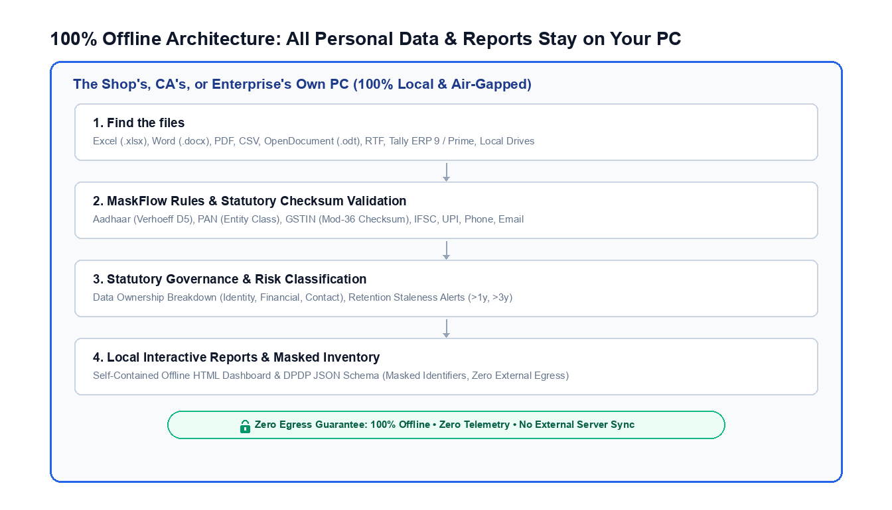
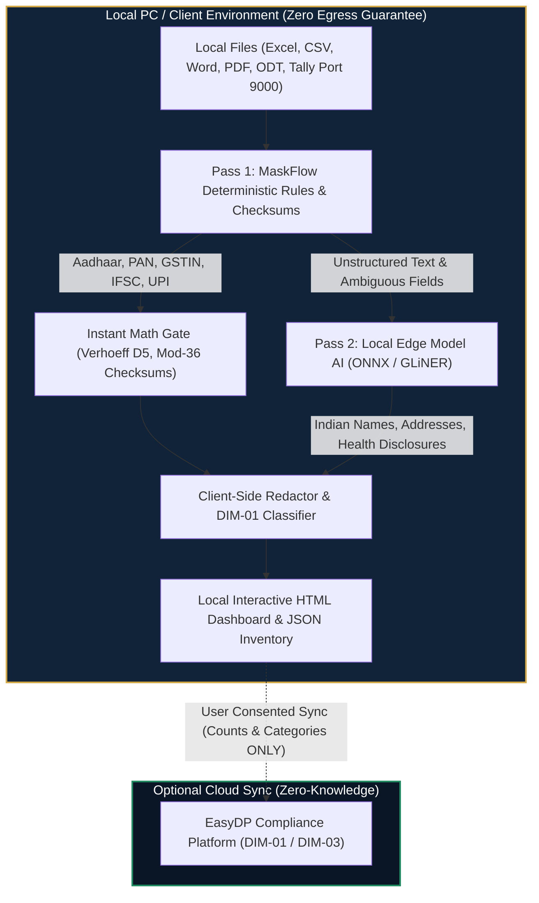

# EasyDP Local PII Scanner

<p align="center">
  <a href="https://easydp.in">
    
  </a>
</p>

<p align="center">
  <strong>Enterprise-grade, 100% offline local PII & B2B scanner for Indian DPDP Act compliance.</strong><br>
  Discover and inventory personal data across local PC storage, shared folders, and Tally ERP with zero cloud uploads.
</p>

<p align="center">
  <a href="https://github.com/easydp-in/pii-scanner/actions/workflows/ci.yml"></a>
  <a href="https://github.com/easydp-in/pii-scanner/actions/workflows/release.yml"></a>
  <a href="https://github.com/easydp-in/pii-scanner/actions/workflows/smoke.yml"></a>
  <a href="https://github.com/easydp-in/pii-scanner/blob/main/LICENSE"></a>
</p>

<p align="center">
  
  
  
  
  <a href="https://pypi.org/project/easydp-pii-scanner/"></a>
  <a href="https://www.npmjs.com/package/easydp-pii-scanner"></a>
  <a href="https://easydp.in"></a>
  <a href="https://easydp-in.github.io/pii-scanner/"></a>
</p>

---

> ### ⚠️ Legal & Compliance Disclaimer
> 1. **Not Legal Advice**: This software is an automated scanner for information governance and privacy risk assessment under India's Digital Personal Data Protection (DPDP) Act, 2023. It does **not** constitute legal advice, statutory audit certification, or an official audit guarantee.
> 2. **User Authorization**: The operator certifies that they have lawful authority and consent to scan target files, drives, or accounting systems.
> 3. **100% Local Guarantee & No Automated Data Sharing**: Scans execute entirely on your machine. The scanner contains **zero telemetry, no background analytics, and no automated data sharing**. No files, metadata, or counts are ever automatically transmitted to EasyDP or any remote server.
> 4. **Safe Masking**: In compliance with the Aadhaar Act regulations, all sensitive identifiers are masked (e.g., `XXXX-XXXX-1234`) across console logs and generated reports.
>
> *Read the full [DISCLAIMER.md](DISCLAIMER.md) before deployment.*

---

## Features

### 1. Comprehensive Coverage for Both B2C & B2B Data
- **B2B Commercial & Tax Identifiers**:
  - **GSTIN**: Validates 15-character Goods and Services Tax Identification Numbers across all Indian states (01–37, 97, 99), verifying the embedded PAN and statutory **Mod-36 check digit**.
  - **Entity-Classified PANs**: Automatically categorizes the 4th character of PAN into:
    - `C` = Incorporated Company (Pvt Ltd / Ltd)
    - `F` = Partnership Firm / Limited Liability Partnership (LLP)
    - `H` = Hindu Undivided Family (HUF)
    - `T` = Trust / NGO
    - `A` = Association of Persons (AOP)
    - `P` = Individual / Sole Proprietor
  - **Tally ERP 9 / Prime Ledgers**: Connects via `localhost:9000` to inspect `Sundry Debtors` (B2B clients) and `Sundry Creditors` (vendors) directly without manual export.
  - **Commercial Banking**: Bank branch IFSC codes (`SBIN0***234`) across payment vouchers and vendor payout sheets.
- **B2C Personal Identifiers**:
  - **Aadhaar Numbers**: Validates the 12th check digit using the **Verhoeff dihedral group algorithm ($D_5$)**. Enforces UIDAI constraints (numbers cannot begin with `0` or `1`).
  - **Indian Mobile Numbers**: Enforces National Numbering Plan (+91 / 0 / 6–9) with digit-boundary isolation, eliminating false substring matches on timestamps or invoice serials.
  - **UPI Virtual Payment Addresses**: Identifies handles (`user@okhdfcbank`, `mobile@paytm`, `name@ybl`) with negative lookahead avoiding email confusion.
  - **Email Addresses**: RFC compliant email pattern matching for personal and corporate mailboxes.
  - **Person Names**: Identifies full names with salutations (`Mr.`, `Dr.`, `Shri`, etc.), labeled prefixes (`Name:`, `Customer Name:`), and tabular columns.
  - **Postal Addresses & Indian PIN Codes**: Recognizes 6-digit Indian PIN codes (`[1-9][0-9]{5}`) and structured physical postal address blocks.

#### Supported PII & Statutory Checksum Matrix

| Identifier Type | DPDP Category | Scope | Statutory Checksum & Validation Logic | Safe Masking Format |
| :--- | :--- | :---: | :--- | :--- |
| **Aadhaar Number** | Identity / Statutory | B2C | **Verhoeff Dihedral ($D_5$) algorithm**; rejects numbers starting with `0` or `1` | `XXXX-XXXX-2562` |
| **PAN Card** | Identity / Tax | B2C & B2B | 4th character entity classification (`P`=Individual, `C`=Company, `F`=Firm/LLP, `T`=Trust, `H`=HUF) | `XXXXX1234F (P)` |
| **GSTIN** | Commercial Tax | B2B | State code (01–37, 97, 99), embedded PAN validation, and **Mod-36 check digit** | `27XXXXX9603R1ZN` |
| **Bank IFSC Code** | Financial / Banking | B2C & B2B | RBI standard 11-char pattern (`^[A-Z]{4}0[A-Z0-9]{6}$`) for branch payment routing | `SBIN0***234` |
| **UPI VPA Handle** | Financial / Payment | B2C & B2B | Payment handles (`user@okhdfcbank`, `mobile@paytm`, `merchant@ybl`, etc.) | `r***a@okhdfcbank` |
| **Indian Mobile** | Contact | B2C & B2B | National Numbering Plan (+91/0/6–9) with digit-boundary isolation | `+91-XXXXX-43210` |
| **Email Address** | Contact | B2C & B2B | RFC-5322 pattern matching for personal and corporate mailboxes | `r***a@example.com` |
| **Person Name** | Identity | B2C & B2B | Salutation & labeled entity detection (`Mr.`, `Dr.`, `Shri`, form labels) + tabular columns | `R***h K***r` |
| **Postal Address** | Contact / Physical | B2C & B2B | Address blocks, street/locality identifiers, apartment/plot numbers | `Plot ***, Sector 14, ...` |
| **Indian PIN Code** | Location / Postal | B2C & B2B | 6-digit Indian postal circles (1–9 zone constraints) + contextual verification | `560***` |

### 2. Multi-Format Document & Data Source Support

#### Document Type Support Matrix

| Category | File Extensions | Extractor Engine | Extracted Scope & Use Cases |
| :--- | :--- | :--- | :--- |
| **Word Documents** | `.docx`, `.dotx` | Native XML Streamer | Paragraphs, tables, headers, and footers (employment contracts, NDAs, HR letters, resumes) |
| **Digital PDFs** | `.pdf` | Pure-Python `pypdf` | Full text across all pages (invoices, salary slips, tax receipts, bank statements) |
| **OpenDocument** | `.odt`, `.ods` | Native XML Streamer | LibreOffice Writer documents & Calc spreadsheets |
| **Rich Text Format** | `.rtf` | RTF Control Stripper | Formatted salary certificates, HR letters, and legacy payroll records |
| **Spreadsheets** | `.xlsx`, `.xlsm` | Streaming `openpyxl` | Row-by-row, column-by-column cell values across all sheets |
| **Delimited Data** | `.csv`, `.tsv` | Streaming CSV parser | Customer records, transaction dumps, CRM exports |
| **Text, Code & Logs** | `.txt`, `.log`, `.md`, `.json`, `.xml`, `.sql`, `.yaml`, `.yml`, `.env` | Chunked Text Stream | App logs, server dumps, configuration files, SQL database dumps |
| **Accounting ERP** | Port 9000 XML | Local Loopback XML | Live Tally ERP 9 / TallyPrime customer ledgers, sundry debtors & creditors |

### 3. Data Ownership & Governance Metrics
- **Types & Quantities Owned**: Surfaces exact counts per PII type and broad categories (*Identity*, *Financial*, *Contact*).
- **High-Risk Exposure Alerts**: Flags sensitive files located in unprotected directories (`Downloads/`, `Desktop/`, shared network drives).
- **Retention Staleness Risk**: Identifies files untouched for >1 year and >3 years to prevent unlawful retention under the DPDP Act.

### 4. Reporting Formats
- **Interactive HTML Dashboard**: Self-contained, responsive offline report with search box, filter pills, distribution charts, and masked previews.
- **DPDP JSON Inventory**: Conforms to `@context: "https://easydp.in/schema/v1/pii-inventory.json"` for enterprise data catalogs.
- **Rich Terminal Summary**: Instant command-line status with EasyDP ASCII banner and colored tables.

### 5. Zero Telemetry & No Automated Data Sharing
- **Complete Local Containment**: All scan counts, file inventories, and reports stay 100% on the local computer.
- **No Background Syncing**: The scanner contains zero background sync agents, analytics beacons, or telemetry.
- **Air-Gapped Operation**: Fully functional on completely disconnected or air-gapped systems with zero degradation.

---

---

## How It Works: The Hybrid Architecture (MaskFlow Rules + Edge Model)

Most traditional PII scanners fail on Indian enterprise data because they use one of two extremes:
1. **Pure Regex Tools**: High false-positive rates on random 12-digit invoice numbers, timestamps, and order codes, with complete inability to identify contextual Indian names.
2. **Heavy Cloud NLP APIs**: Require uploading sensitive employee and customer files to third-party cloud servers, directly violating the data minimization and security mandates of India's DPDP Act, 2023.

EasyDP solves this with an air-gapped **Hybrid Dual-Engine Architecture** running 100% locally on the user's PC:





### 1. Pass 1: MaskFlow Deterministic Rules (Fast Statutory Checksum Gate)
- **Role**: Handles 90%+ of structured tabular and document data at **>5,000 records/second**.
- **Statutory Checksum Verification**:
  - **Aadhaar**: Enforces UIDAI's **Verhoeff dihedral group ($D_5$) checksum**. Arbitrary 12-digit serial numbers fail immediately; rejects numbers beginning with `0` or `1`.
  - **GSTIN**: Validates state jurisdiction codes (01–37, 97, 99), checks the embedded 10-character PAN, and verifies the 15th **Mod-36 check digit**.
  - **PAN**: Evaluates statutory structure (`[A-Z]{3}[PCHFATBLJG][A-Z]\d{4}[A-Z]`) and decodes the 4th character legal entity classification (`P`=Individual, `C`=Company, `F`=Firm/LLP, `T`=Trust, `H`=HUF).
  - **Banking & UPI**: RBI-compliant IFSC routing codes and UPI Virtual Payment Addresses (VPAs).
- **Zero False-Positive Guarantee**: If an Aadhaar number passes Verhoeff and UIDAI rules, the probability of an accidental match on random digits is <0.01%.

### 2. Pass 2: Local Edge Model AI (Contextual & Unstructured PII)
- **The Challenge**: Statutory checksums cannot catch unstructured PII: **Indian person names** ("Ramesh Kumar", "Priya Sharma"), physical residential addresses, medical diagnoses, or children's personal data. Pure rule-based tools score poorly on Indian names (<30% accuracy).
- **The Edge Model**: A lightweight, local Named Entity Recognition (NER) model (GLiNER / ONNX Runtime architecture, 200–500MB) running entirely on CPU.
- **Hardware-Friendly**: Engineered for standard SMB and CA office PCs (Intel Core i3, 8GB RAM, zero GPU required).
- **Air-Gapped Inference**: Model weights execute in-process. Zero text, sentences, or embeddings ever leave the host machine.

### 3. In-Memory Streaming & Security Guardrails
- **Resource-Bounded Streams**: CSV, TSV, and logs are parsed line-by-line via memory-safe generators without buffering large files into memory.
- **Decompression Bomb Defense**: Office XML archives (`.docx`, `.odt`, `.xlsx`) are guarded by strict thresholds (`MAX_UNCOMPRESSED_ENTRY_SIZE = 50MB`, `MAX_TOTAL_UNCOMPRESSED_SIZE = 150MB`) to eliminate DoS memory attacks.
- **Tally ERP Localhost Loopback**: Connects directly to Tally ERP 9 / Prime via `127.0.0.1:9000` XML export. Strictly loopback-only to prevent Server-Side Request Forgery (SSRF).

### 4. Client-Side Redaction & Governance Auditing
- **Zero-Plaintext Redaction**: Every sensitive token is masked immediately at extraction time (`XXXX-XXXX-1234`, `XXXXX1234F`, `27XXXXX9603R1ZN`). Plaintext is never stored in reports or memory dumps.
- **Data Inventory Mapping (DIM-01)**: Categorizes all findings into statutory DPDP groups: *Identity & Official Identifiers*, *Financial & Banking Details*, and *Contact & Communications*.
- **Retention Staleness Risk**: Flags files unedited for >1 year and >3 years to prevent unlawful retention under Section 8(7) of the DPDP Act.
- **High-Risk Exposure Analysis**: Automatically highlights unprotected folders (`Downloads/`, `Desktop/`) containing sensitive identifiers.

### 5. Offline Reporting & Optional Zero-Knowledge Sync
- **Local Artifacts**: Outputs self-contained interactive HTML dashboards (`reports/scan_report.html`) and structured JSON inventory catalogs (`reports/scan_report.json`).
- **Optional Zero-Knowledge Cloud Sync**: If (and only if) the operator consents, sends aggregate metrics (data types, counts, and category summaries) to the EasyDP platform to populate the enterprise Data Inventory (DIM-01). File contents and raw customer identities are **never** transmitted.

---

## Installation

Choose the installation method suited for your platform:

### Method 1: Pre-Compiled Standalone Binaries & Mac App (Recommended for SMBs & CAs)
Requires **zero Python or Node installation**. Download from [GitHub Releases](https://github.com/easydp-in/pii-scanner/releases/latest):
- **macOS App & Launcher**: `EasyDP-Scanner-macOS.zip` (Unzip and launch **`EasyDP Scanner.app`** or double-click `easydp-scan.command`!)
- **macOS Universal CLI**: `easydp-scan-macos-universal` (Apple Silicon & Intel)
- **Windows**: `easydp-scan-windows-amd64.exe` (run from PowerShell/CMD)
- **Linux**: `easydp-scan-linux-amd64`

> [!TIP]
> **Running on macOS**:
> - **Option A (Desktop App)**: Download `EasyDP-Scanner-macOS.zip`, unzip, and launch **`EasyDP Scanner.app`** (or drag to `/Applications`).
> - **Option B (Finder Double-Click)**: Double-click `easydp-scan.command` to run an interactive terminal audit.
> - **Option C (Terminal CLI)**:
>   ```bash
>   chmod +x ./easydp-scan-macos-universal
>   ./easydp-scan-macos-universal scan .
>   ```

### Method 2: One-Line Install Script
**On macOS & Linux:**
```bash
curl -fsSL https://raw.githubusercontent.com/easydp-in/pii-scanner/main/scripts/install.sh | bash
```

**On Windows (PowerShell):**
```powershell
irm https://raw.githubusercontent.com/easydp-in/pii-scanner/main/scripts/install.ps1 | iex
```

### Method 3: NPM / NPX (Zero-Install Runner)
```bash
# Run instantly with zero installation via npx:
npx easydp-pii-scanner scan ./my-data

# Or install globally:
npm install -g easydp-pii-scanner
easydp-scan scan . --format html,json
```

### Method 4: Python / Pip / Pipx
```bash
# Standard installation from PyPI:
pip install easydp-pii-scanner
easydp-scan scan . --format html,json

# Or isolated CLI execution via pipx:
pipx run easydp-pii-scanner scan .
```

### Method 5: Homebrew (macOS & Linux)
```bash
brew tap easydp-in/tap
brew install easydp-scan
```

### Method 6: One-Click Prompt for AI Agents & LLMs 🤖
*(Claude Code, Cursor Composer, GitHub Copilot, Gemini CLI, Antigravity, Roo, Aider)*

Copy and paste the block below directly into your AI coding assistant or terminal:

```text
Please install and execute the EasyDP Local PII Scanner on this machine:

1. Detect the operating system (Windows, macOS, or Linux) and active shell environment.
2. Install the scanner using the fastest available method:
   - If Python 3.10+ is available: `pip install easydp-pii-scanner`
   - If Node.js is present: run directly with `npx easydp-pii-scanner scan .`
   - On macOS/Linux terminal: `curl -fsSL https://raw.githubusercontent.com/easydp-in/pii-scanner/main/scripts/install.sh | bash`
   - On Windows PowerShell: `irm https://raw.githubusercontent.com/easydp-in/pii-scanner/main/scripts/install.ps1 | iex`
3. Verify the installation: `easydp-scan --version`
4. Run a local DPDP compliance scan on the current project or workspace:
   `easydp-scan scan . --format html,json,cli --output-dir ./reports`
   (Or use `easydp-scan scan --user-dirs --output-dir ./reports` to scan Downloads, Desktop, and Documents)
5. Report the location of `./reports/scan_report.html` and summarize the PII counts discovered.
Important: EasyDP Local PII Scanner is 100% offline with zero telemetry. Never transmit, export, or send scanned file contents or reports to any remote server or external API.
```

---

## Multi-OS & Installation Coverage in CI/CD

Our GitHub Actions pipeline continuously tests the scanner across operating systems and distribution channels:

| Operating System | Unit & Integration | E2E Isolation | Pip Package | NPM Wrapper | Shell / PS1 Script | PyInstaller Binary |
| :--- | :---: | :---: | :---: | :---: | :---: | :---: |
| **Ubuntu Linux (x86_64)** | ✅ | ✅ | ✅ | ✅ | ✅ (`install.sh`) | ✅ |
| **macOS (Universal / Apple Silicon)** | ✅ | ✅ | ✅ | ✅ | ✅ (`install.sh`) | ✅ |
| **Windows 10/11 (AMD64)** | ✅ | ✅ | ✅ | ✅ | ✅ (`install.ps1`) | ✅ (`.exe`) |

---

## Quickstart & Usage

### 1. Scan Local Files & Folders
```bash
# Scan current folder and generate HTML & JSON reports in ./reports:
easydp-scan scan . --format html,json,cli --output-dir ./reports

# Scan customer exports on a specific drive:
easydp-scan scan "D:\Client_Accounts" --format html --output-dir ./reports

# Exclude temporary or build directories:
easydp-scan scan . --exclude "node_modules,temp_archive"

# Custom log file path for troubleshooting:
easydp-scan scan . --log-file ./reports/scanner.log

# Quiet mode for automated CI/CD pipelines:
easydp-scan scan ./data -f json -q
```

> **Real-Time Analysis & Clean Terminal Logging**: The scanner includes a live progress bar tracking file analysis across directories. Raw library warnings (from `openpyxl`, `pypdf`, etc.) are cleanly suppressed from the terminal and routed to `reports/scanner.log` for troubleshooting. Clickable `file://` hyperlinks are printed upon completion for instant one-click report access.


### 2. Audit Local Tally ERP
Ensure Tally ERP 9 or Tally Prime is running on your machine (ODBC/HTTP port 9000 enabled):
```bash
easydp-scan tally --port 9000 --format html,cli --output-dir ./tally_reports
```

---

## Sample Report Outputs

EasyDP Local PII Scanner generates three distinct reporting formats locally with **safe masking on all personal identifiers**:

### 1. Rich Terminal Console Output
When executed from the command line, the scanner renders an EasyDP branded ASCII banner, a DPDP compliance overview, a data ownership breakdown by type, and a location registry of sensitive files:

```text
  ______               _____  _____
 |  ____|             |  __ \|  __ \
 | |__   __ _ ___ _   | |  | | |__) |
 |  __| / _` / __| | || |  | |  ___/
 | |___| (_| \__ \ |_|| |__| | |
 |______\__,_|___/\__,|_____/|_|
                  __/ |  .in
                 |___/   Local PII Scanner

EasyDP Local PII Scanner
Enterprise-grade, 100% offline DPDP compliance scanner | https://easydp.in

+------------------------------------------------------------------------------+
| [!] LEGAL & COMPLIANCE DISCLAIMER                                            |
| 1. NOT LEGAL ADVICE: Assists with information governance under DPDP Act 2023.|
| 2. USER AUTHORIZATION: Operator certifies lawful authority to scan targets.  |
| 3. PRIVACY GUARANTEE: Scans run 100% locally. Zero personal data leaves PC.  |
| 4. MASKING: All sensitive values (Aadhaar, PAN, etc.) are strictly masked.   |
+------------------------------------------------------------------------------+
                        Scan Overview & DPDP Metrics                         
+-------------------------------+----------------------------------------------+
| Metric                        | Value                                        |
+-------------------------------+----------------------------------------------+
| Target Path                   | ./sample_data                                |
| Scan Timestamp (UTC)          | 2026-10-18 09:46:48                          |
| Total Files Scanned           | 4                                            |
| Sensitive Files Identified    | 3                                            |
| Clean Files                   | 1                                            |
| Total Sensitive PII Instances | 22                                           |
| High-Risk Exposure Files      | 1 (Downloads/Desktop/Exports)                |
| Retention Alert (>1y old)     | 0                                            |
| Retention Alert (>3y old)     | 0                                            |
+-------------------------------+----------------------------------------------+
      Data Ownership Breakdown (Types & Quantities)       
+----------------------+----------------+----------------+
| PII Data Type        | Quantity Found | Share of Total |
+----------------------+----------------+----------------+
| PAN Card             |              6 |          27.3% |
| Indian Mobile Number |              5 |          22.7% |
| UPI VPA Handle       |              4 |          18.2% |
| Email Address        |              4 |          18.2% |
| Aadhaar Number       |              2 |           9.1% |
| GSTIN (Tax ID)       |              1 |           4.5% |
+----------------------+----------------+----------------+
                       Sensitive Files & Findings Details                       
+-----------------------+-----------+-----------------------+------------------+
| File Name             | PII Count | Findings Breakdown    | Sample Masked    |
+-----------------------+-----------+-----------------------+------------------+
| vendor_agreement.docx |         3 | Aadhaar: 1, PAN: 1,   | XXXX-XXXX-2562,  |
|                       |           | GSTIN: 1              | XXXXX1234F       |
| customers_sample.csv  |        17 | Mobile: 4, UPI: 4,    | +91-XXXXX-43210, |
|                       |           | Email: 4, Aadhaar: 1  | r***a@example    |
| salary_certificate.rtf|         2 | PAN: 1, Mobile: 1     | XXXXX5678K       |
+-----------------------+-----------+-----------------------+------------------+
```

### 2. Interactive Offline HTML Dashboard (`scan_report.html`)
The HTML dashboard is **100% self-contained** (inline CSS and zero external JavaScript/CDN dependencies). Features include:
- **Real-Time Search**: Instant fuzzy filtering by filename, PII type, or file extension.
- **Filter Pills**: One-click pills to isolate high-risk folders (`Desktop`, `Downloads`) and stale files (>1y, >3y retention risk).
- **Statutory Categories Chart**: Visual distribution across *Identity & Official*, *Financial & Banking*, and *Contact Details*.
- **Location Breadcrumb**: Exact paragraph (`Para 3`), page (`Page 2`), row (`Row 14`), or line index where sensitive data resides.
- **Offline Sharing**: Can be emailed, archived, or opened in any modern browser without an internet connection.

### 3. DPDP JSON Data Inventory Schema (`scan_report.json`)
Conforms to `@context: "https://easydp.in/schema/v1/pii-inventory.json"` for programmatic integration with enterprise data catalogs:

```json
{
  "@context": "https://easydp.in/schema/v1/pii-inventory.json",
  "generator": "EasyDP Local PII Scanner v0.1.0 (https://easydp.in)",
  "legal_disclaimer": "This document is an automated technical data inventory generated for privacy governance under the DPDP Act 2023. Scans ran 100% locally with zero remote data egress.",
  "data_ownership_inventory": {
    "target_path": "./sample_data",
    "scan_timestamp": "2026-10-18T09:51:02.268176+00:00",
    "total_files_scanned": 4,
    "total_sensitive_files": 3,
    "total_clean_files": 1,
    "total_pii_instances": 22,
    "by_category": {
      "Identity & Official Identifiers": 8,
      "Financial & Banking Details": 5,
      "Contact & Communications": 9
    },
    "by_type": {
      "Aadhaar Number": 2,
      "PAN Card": 6,
      "GSTIN (Tax ID)": 1,
      "Indian Mobile Number": 5,
      "UPI VPA Handle": 4,
      "Email Address": 4
    },
    "high_risk_files": [
      "./sample_data/customers_sample.csv"
    ],
    "retention_staleness": {
      "files_over_1_year": 0,
      "files_over_3_years": 0
    }
  },
  "findings": [
    {
      "file_name": "vendor_agreement.docx",
      "file_size_bytes": 487,
      "is_sensitive": true,
      "findings_count": 3,
      "findings_by_type": {
        "Aadhaar Number": 1,
        "PAN Card": 1,
        "GSTIN (Tax ID)": 1
      },
      "sample_findings": [
        {
          "pii_type": "Aadhaar Number",
          "masked_value": "XXXX-XXXX-2562",
          "location": "document, Para 2",
          "confidence": 1.0
        }
      ]
    }
  ]
}
```

---

## Troubleshooting & FAQs

### Q1: Is my data uploaded to any cloud or external server?
**No.** EasyDP Local PII Scanner is built strictly with an offline-first architecture. All file discovery, text extraction, checksum validation, and report generation execute 100% locally on your machine. Our automated test suite includes socket-level hooks that fail the build if any outbound network connection is attempted during a scan.

### Q2: Does the scanner cover B2B data (suppliers, vendors, corporate clients)?
**Yes.** The scanner covers B2B data through:
1. **GSTIN Checksum Validation**: Validates 15-digit GST numbers for suppliers and commercial parties.
2. **Entity-Classified PANs**: Distinguishes companies (`C`), partnership firms (`F`), trusts (`T`), and HUFs (`H`) from individual proprietors (`P`).
3. **Sole Proprietors**: Under the DPDP Act 2023, sole proprietorship data **is** personal data because it uses the proprietor's personal PAN and name. EasyDP identifies this automatically.
4. **Tally ERP Ledgers**: Directly scans `Sundry Creditors` (suppliers) and `Sundry Debtors` (buyers).

### Q3: How do I scan Tally ERP 9 or Tally Prime?
1. Open Tally ERP 9 or Tally Prime.
2. Ensure local ODBC/HTTP server is enabled in Tally:
   - Go to `F12: Configure` > `Advanced Configuration`.
   - Set **Tally is acting as** to `Both` or `Server`.
   - Set **Port** to `9000`.
3. Open your terminal or Command Prompt and run:
   ```bash
   easydp-scan tally --port 9000
   ```
4. If Tally is closed or not listening, the scanner will inform you with a clear notice without crashing.

### Q4: Why didn't a 12-digit number get flagged as an Aadhaar number?
Aadhaar validation is **not** a simple 12-digit regex match. It enforces statutory checksum rules:
- Must pass the **Verhoeff dihedral algorithm** ($D_5$) on the 12th check digit.
- UIDAI rules dictate that legitimate Aadhaar numbers never begin with `0` or `1`.
Random 12-digit transaction numbers, barcodes, or credit card substrings fail the Verhoeff check and are ignored to avoid false alarms.

### Q5: How do I run this on a non-technical accountant's Windows machine?
Download the standalone executable `pii-scanner-windows-amd64.exe` from [Releases](https://github.com/easydp-in/pii-scanner/releases). No Python or dependencies are required. Simply open PowerShell or Command Prompt in the folder and run:
```powershell
.\pii-scanner-windows-amd64.exe scan "C:\Users\Admin\Documents"
```

### Q6: How do I open and share the generated HTML report?
The generated `scan_report.html` is completely self-contained. It contains inline CSS and vanilla JavaScript with zero external CDN dependencies:
- Double-click the file to open it in Chrome, Edge, Safari, or Firefox.
- Works 100% offline (you can unplug your Wi-Fi and the report still functions).
- You can print or save it as a PDF directly from your browser (`Ctrl+P` / `Cmd+P`).

### Q7: What if I have huge Excel sheets or multi-gigabyte CSVs?
EasyDP Local PII Scanner uses memory-efficient streaming:
- CSVs are parsed row-by-row without buffering the whole file in memory.
- Excel files (`.xlsx`) use `openpyxl` read-only streaming mode.
- If you have specific folders you wish to skip, pass `--exclude "folder_name"`.

---

## Test-Driven Development (TDD) Commands

```bash
# Run all Unit, Integration, E2E, and Smoke tests:
pytest tests/ -v --cov=pii_scanner --cov-report=term-missing

# Run privacy network isolation test:
pytest tests/e2e/test_privacy_network_isolation.py -v

# Run linting and type analysis:
ruff check . && ruff format --check . && mypy src/
```

---

## Contributing & License

Contributions are welcome! Please follow [CONTRIBUTING.md](CONTRIBUTING.md) for conventional commits.

Copyright © 2026 [EasyDP](https://easydp.in).  
Distributed under the **Apache License, Version 2.0**. See [LICENSE](LICENSE) for details.
